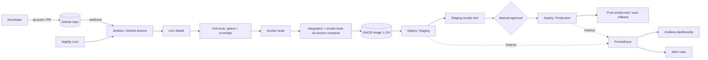

# Architecture

## Environments
| Env | Runtime | Replicas | Purpose |
|---|---|---|---|
| CI | docker compose on runner | 1 | integration + smoke tests |
| Staging | k8s namespace `taskflow-staging` (or VM via Ansible) | 1 | pre-prod verification |
| Production | k8s namespace `taskflow-production` (or VM via Ansible) | 3 (HPA 2–5) | live service |
